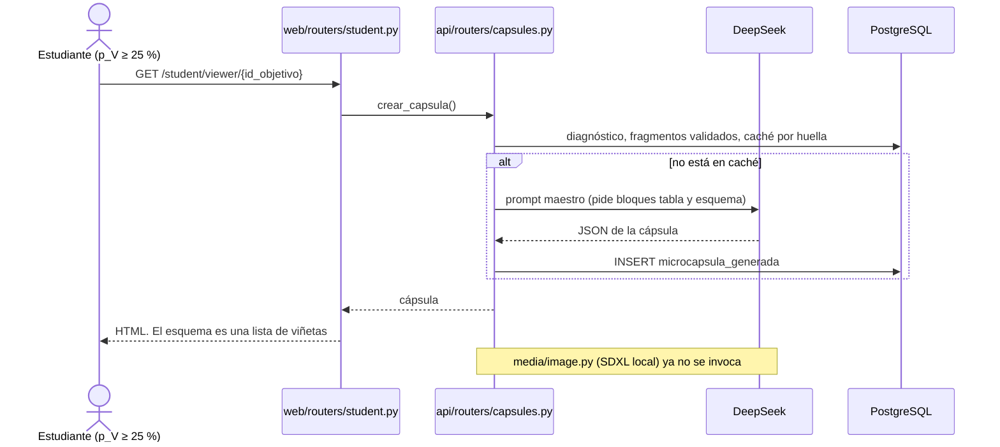
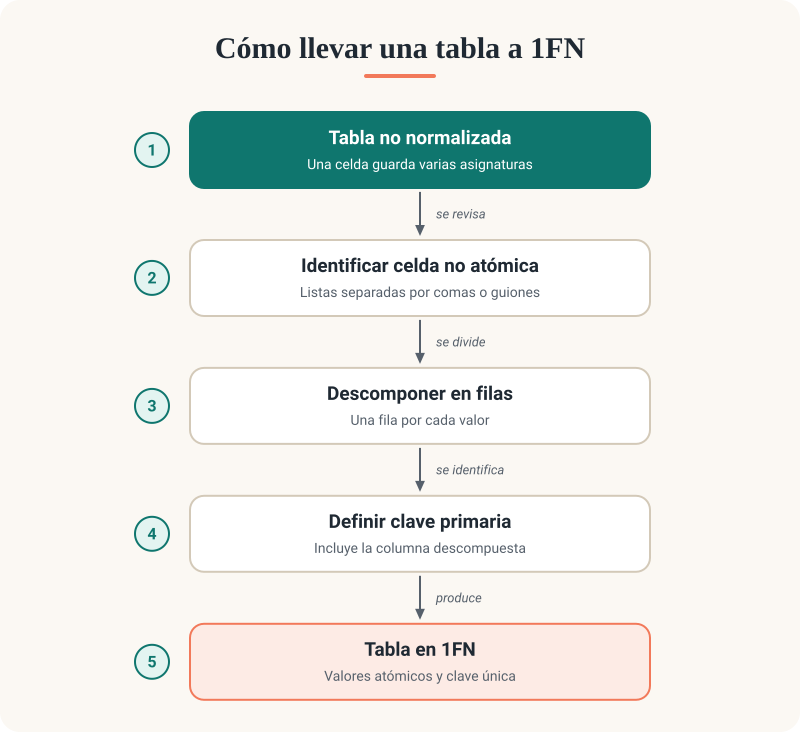
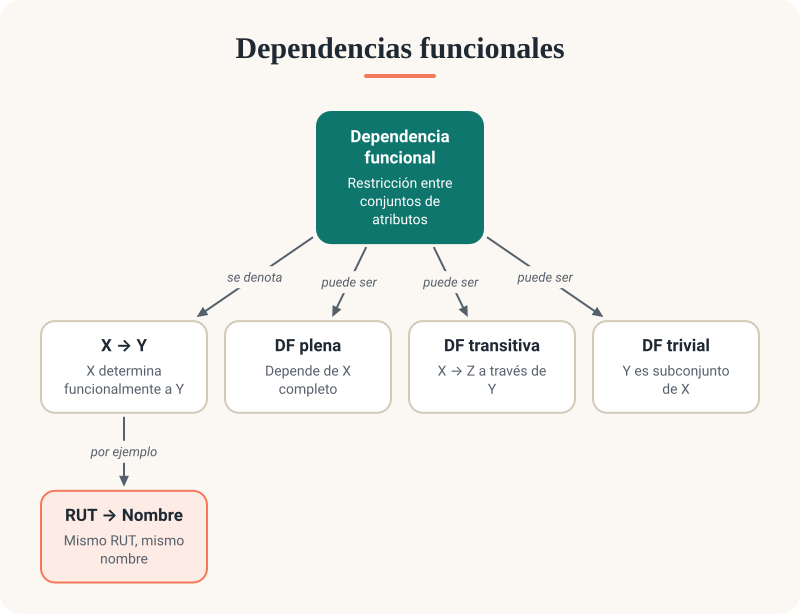
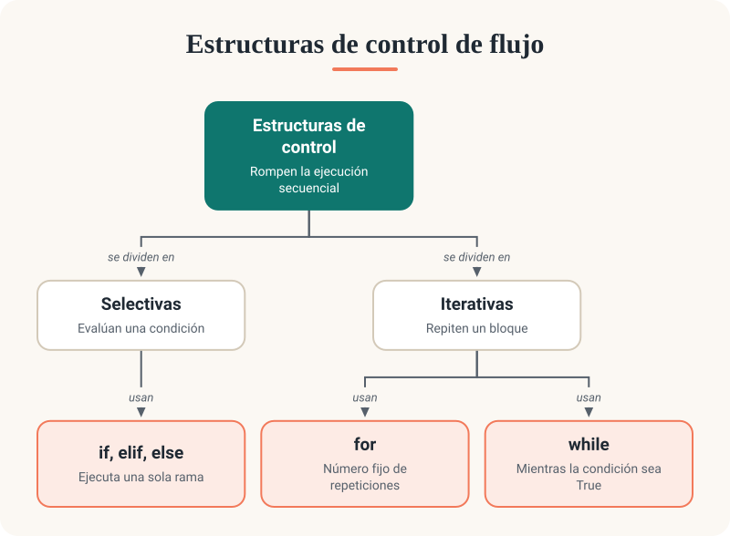

# Módulo Visual (perfil VARK): análisis y propuesta

**Fecha del análisis y de verificación de todos los datos de mercado:** 10-oct-2026.
**Alcance:** solo lectura del repositorio. Todo lo creado está en `docs/modulo-visual/`.
**No se gastó dinero:** no se llamó a ninguna API de imágenes ni al LLM.

Convención de este informe: **✅ oficial** es un dato leído hoy en la página del proveedor; **🟡 secundario** viene de un tercero; **❓ no verificado** no se pudo confirmar.

---

## 1. Resumen ejecutivo

1. **Recomendación principal: no usar un modelo de imagen para el esquema.** El LLM de texto que ya usamos (DeepSeek) entrega una especificación JSON y nosotros la dibujamos como SVG con plantillas propias.
2. **Por qué:** el texto sale exacto, con tildes y ñ, porque lo escribe un motor tipográfico y no un modelo de difusión. Es lo mismo que el equipo ya concluyó en `docs/decicionesIAlocal.md` §10 tras probar FLUX.2 klein en local.
3. **Ya funciona como prototipo:** los 3 ejemplos con contenido real del repo se dibujaron en menos de 1 ms cada uno (`pruebas/resultados/deterministico/`).
4. **Costo de la opción principal:** ~US$0,002 por lección (una llamada extra a DeepSeek). El proyecto completo, incluido el desarrollo, queda bajo US$1 (≈ CLP 1.000).
5. **Plan B:** Nano Banana 2.1 de Google (`gemini-nano-banana-2.1`), US$0,0336 por imagen a 1K ✅, detrás de un adaptador `ImageProvider`. Tope sugerido: US$10 prepagados (≈ CLP 9.800).
6. **El caché es por lección, no por estudiante:** una infografía por objetivo y versión del material, reutilizada por todos los estudiantes Visual. Sin ese caché, el plan B costaría 43 veces más en la cohorte actual.
7. **Lo que no se pudo probar:** los candidatos de IA. El `.env` solo tiene la key del LLM. El script quedó listo; correrlo cuesta ~US$0,76, más la recarga mínima de cada proveedor.
8. **Decisión que necesito de ustedes:** aprobar la opción principal, y decir si quieren pagar la comparación con IA antes de implementar.

---

## 2. Cómo funciona hoy y flujo propuesto

### 2.1 Stack actual

| Capa | Qué hay | Dónde |
|---|---|---|
| Backend | FastAPI + Uvicorn, Python ≥ 3.11, handlers síncronos | `src/studify/main.py` |
| Frontend | Jinja2 renderizado en servidor + HTMX 1.9.10 propio, CSS propio, fuentes autoalojadas (Figtree, Fraunces). Sin CDN ni framework JS | `src/studify/web/` |
| Base de datos | PostgreSQL 16 (Docker Compose), SQLAlchemy 2 + Alembic, JSONB para la cápsula | `src/studify/db/models.py` |
| LLM | DeepSeek por API compatible con OpenAI: `LLM_BASE_URL=https://api.deepseek.com/v1`, `LLM_MODEL=deepseek-chat`, vía `llama-index-llms-openai-like`, modo JSON, hasta 2 reparaciones | `src/studify/generation/generator.py` |
| Audio (perfil A) | Kokoro / Piper en local, bajo demanda desde el visor, caché por huella del guion | `src/studify/media/audio.py` |
| Imagen (perfil V) | Código local con SDXL sobre DirectML, **desconectado** | `src/studify/media/image.py` |

### 2.2 Dónde se adapta por VARK y qué existe del módulo Visual

- **Reglas:** `vark/rules.py::_cantidad_recursos_visuales` da `recursos_visuales` 0, 1 o 2 según p_V (< 25 %, 25–39 %, ≥ 40 %). Con p_V ≥ 40 % agrega las directivas `incluir_mapa_conceptual`, `tabla_comparativa` y `estructura_jerarquica`.
- **Prompt:** `rag/prompts/maestro.py` traduce esas directivas en bloques `tabla` y `esquema` dentro del JSON de la cápsula.
- **Render:** `web/templates/student/_capsula.html` dibuja el bloque `esquema` como una lista `<ul>`. **Ese es hoy todo el "visual": una lista con viñetas.** No hay flechas ni relaciones.
- **Restos del intento anterior:**
  - `media/image.py` y `media/generator.py`: nadie los llama desde el 04-oct (hallazgo H5, comentario en `api/routers/capsules.py:375`). El docstring dice Z-Image, el código carga SDXL y el log dice FLUX.1.
  - `tests/test_visual.py`: ejecuta la generación al importarse y rompe `pytest` (hallazgo H8).
  - Extra `media` de `pyproject.toml` (torch, diffusers): sin uso.
  - `config.py::media_dir` (`data/media`): carpeta vacía que ninguna plantilla sirve.
  - No hay endpoint, tabla ni variable de entorno para imágenes.
- **Decisión previa del equipo:** `docs/decicionesIAlocal.md` §10 y `PLAN_DESARROLLO.md` §5 ya dicen que los diagramas con rótulos deben generarse con código vectorial (SVG o Mermaid). Esta propuesta lo concreta.

### 2.3 Flujo actual



### 2.4 Flujo propuesto

```mermaid
sequenceDiagram
    actor D as Docente
    actor E as Estudiante Visual
    participant W as Visor (student.py + HTMX)
    participant V as media/visual.py
    participant DB as PostgreSQL (recurso_visual)
    participant L as LLM de texto (DeepSeek)
    participant P as ImageProvider

    Note over D,P: Camino A (preferido): se genera al curar el material
    D->>V: valida fragmentos o pulsa «Generar esquema»
    V->>DB: ¿existe la huella (objetivo + fragmentos + versión)?
    alt no existe
        V->>DB: INSERT estado = pendiente
        V->>L: fragmentos validados → especificación JSON
        L-->>V: JSON (se valida; hasta 2 reparaciones)
        V->>P: generar(especificación)
        P-->>V: SVG propio, o PNG de una API
        V->>DB: UPDATE estado = listo
    end

    Note over E,P: Camino B: la primera visita, si nadie lo generó antes
    E->>W: GET /student/viewer/{id_objetivo}
    W-->>E: cápsula completa de inmediato + hueco «Preparando tu esquema…»
    E->>W: GET /student/viewer/{id_capsula}/visual (HTMX, al cargar)
    W->>V: obtener_o_generar(id_objetivo)
    V->>DB: busca por huella
    alt listo
        W-->>E: figura con el esquema
    else pendiente (otro estudiante lo está generando)
        W-->>E: mismo hueco, reintenta en 3 s
    else falló o no hay proveedor
        W-->>E: nada. Se queda el bloque esquema actual
    end
```

### 2.5 Cuándo generar, caché y almacenamiento

| Pregunta | Propuesta | Razón |
|---|---|---|
| ¿Por estudiante o por lección? | **Por lección** (objetivo + versión del material) | El esquema muestra la estructura del contenido, que no depende del perfil. El perfil solo decide si se muestra |
| ¿Cuándo? | Al validar el material (camino A), con generación perezosa en la primera visita como respaldo (camino B) | Con A los estudiantes solo leen caché. B evita que un olvido deje la lección sin esquema |
| ¿A quién se le muestra? | A quien tenga `recursos_visuales > 0`, es decir p_V ≥ 25 % | Es el umbral que ya usa `vark/rules.py` |
| Clave de caché | `sha256(versión del esquema, id_objetivo, ids y hash del texto de los fragmentos validados, modelo LLM, proveedor, modelo de imagen, versión de la plantilla)` | Mismo criterio que `rag/orchestrator.huella()`: todo lo que cambia la salida y nada más |
| Invalidación | No se borra nada. Si el docente valida o descarta un fragmento, la huella cambia y se genera una fila nueva | Es la política vigente de las cápsulas: se versiona, no se sobrescribe |
| Dónde se guarda | Tabla nueva `recurso_visual`: `huella` única, `id_objetivo`, `spec_json` (JSONB), `proveedor`, `modelo`, `estado`, `error`, `costo_usd`, `ruta_archivo`, `fecha` | Ya prevista como `recurso_multimedia` en `PLAN_DESARROLLO.md` §4 |
| Archivo | Determinístico: **ninguno**, el SVG se dibuja desde `spec_json` en cada request (< 1 ms). IA: `data/media/visual/{huella}.png`, servido por una ruta con sesión | `data/` ya está en `.gitignore`. Evita repetir el problema de `src/studify/public/audio` (H10) |
| CDN | No hace falta: 4 objetivos y 43 estudiantes. En un despliegue en la nube, mover los PNG a un bucket (R2, S3, GCS) | |

Supuesto documentado: asumo que editar el texto de un fragmento conserva su `id_fragmento`; por eso la huella incluye también el hash del texto.

### 2.6 Errores, tiempos de espera y fallback

- **No bloquear la cápsula.** El visor ya tarda varios segundos en el GET porque genera la cápsula ahí. El esquema se pide aparte con HTMX, igual que el audio.
- **Segundo plano:** el camino A usa `BackgroundTasks` de FastAPI. No hace falta una cola (Celery, RQ) a esta escala.
- **Estampida:** si 43 estudiantes abren la misma lección a la vez, la restricción única sobre `huella` con `estado = pendiente` deja generar a uno solo; el resto espera y reintenta.
- **Timeout:** 20 s para el LLM de la especificación, 60 s para una API de imagen. OpenAI advierte hasta 2 minutos en prompts complejos ✅.
- **Reintentos:** uno, con espera, ante 429 o 5xx. Si falla, `estado = fallido` y no se reintenta solo durante 10 minutos.
- **Fallback:** el bloque `esquema` que la cápsula ya trae. El estudiante nunca ve un error por el visual.
- **Rate limits:** Gemini los publica solo dentro de AI Studio ❓. Ideogram: 10 solicitudes simultáneas ✅. Con caché por lección el volumen real es de unidades por día.

### 2.7 Puntos de integración en el código

| Archivo | Cambio |
|---|---|
| `src/studify/media/visual.py` (nuevo) | Contrato Pydantic `EspecificacionVisual`, huella, `obtener_o_generar()`, render SVG. El render sale casi tal cual de `docs/modulo-visual/pruebas/generar_pruebas.py` |
| `src/studify/media/proveedores.py` (nuevo) | `ImageProvider` y sus adaptadores (§8) |
| `src/studify/rag/prompts/visual.py` (nuevo) | Prompt del paso LLM (§3.2) |
| `src/studify/db/models.py` + migración Alembic | Tabla `recurso_visual` |
| `src/studify/web/routers/student.py` | `get_viewer` pasa `visual_activo`; ruta nueva `GET /student/viewer/{id_capsula}/visual` |
| `src/studify/web/templates/student/_capsula.html` | Hueco HTMX al inicio de `#paso-desarrollo`; parcial nuevo `student/_visual.html` |
| `src/studify/web/routers/teacher.py` y `teacher/simulator.html` | Vista previa, «Regenerar» y aprobación del esquema |
| `src/studify/config.py` y `.env.example` | `VISUAL_PROVEEDOR` (`determinista`, `gemini`, `off`), `IMAGE_MODEL`, `IMAGE_API_KEY`, `IMAGE_TIMEOUT` |
| `src/studify/media/image.py`, `media/generator.py`, `tests/test_visual.py`, extra `media` | Retirar: es el SDXL local descartado. De paso se cierra H8 |

---

## 3. Diseño del prompt

### 3.1 Esquema JSON de la especificación

```json
{
  "$schema": "https://json-schema.org/draft/2020-12/schema",
  "title": "EspecificacionVisual",
  "type": "object",
  "required": ["version", "titulo", "tipo_de_diagrama", "nodos", "relaciones", "paleta", "estilo", "texto_alternativo"],
  "properties": {
    "version": { "const": 1 },
    "titulo": { "type": "string", "description": "Máximo 6 palabras" },
    "tipo_de_diagrama": {
      "enum": ["mapa_conceptual", "flujo", "comparacion", "linea_de_tiempo", "jerarquia", "ciclo", "causa_efecto"]
    },
    "nodos": {
      "type": "array", "minItems": 3, "maxItems": 7,
      "items": {
        "type": "object",
        "required": ["id", "etiqueta"],
        "properties": {
          "id": { "type": "string", "pattern": "^n[1-9]$" },
          "etiqueta": { "type": "string", "description": "Máximo 4 palabras" },
          "detalle": { "type": "string", "description": "Opcional, máximo 8 palabras. Solo lo usa el render determinístico" },
          "rol": { "enum": ["principal", "secundario", "resultado", "decision"], "default": "secundario" },
          "grupo": { "type": "string", "description": "Columna en `comparacion`; marca temporal en `linea_de_tiempo`" }
        }
      }
    },
    "relaciones": {
      "type": "array",
      "items": {
        "type": "object",
        "required": ["desde", "hacia", "verbo"],
        "properties": {
          "desde": { "type": "string" },
          "hacia": { "type": "string" },
          "verbo": { "type": "string", "description": "Máximo 3 palabras" }
        }
      }
    },
    "paleta": { "enum": ["studify", "azul", "violeta"] },
    "estilo": { "enum": ["plano"] },
    "texto_alternativo": { "type": "string", "description": "1 o 2 oraciones que describen el diagrama" },
    "fuentes": { "type": "array", "items": { "type": "integer" }, "description": "id_fragmento usados" }
  }
}
```

Tres decisiones que se apartan de lo pedido, con su razón:

- **`paleta` es un nombre, no colores.** Si el LLM elige hexadecimales, tarde o temprano elige un par sin contraste. Cada nombre apunta a tokens de `app.css` ya revisados.
- **`texto_alternativo` es obligatorio.** Es lo que lee un lector de pantalla y lo único que hace accesible una imagen PNG.
- **`fuentes`** aplica al esquema la misma regla 5 de las cápsulas: solo se cita material inyectado.

Reglas que valida el código y no el esquema: ids únicos, relaciones hacia nodos existentes, `jerarquia` sin ciclos y con un solo padre por nodo, `ciclo` cerrado, `comparacion` con `grupo` en todos los nodos. En `flujo`, `linea_de_tiempo` y `ciclo`, el orden de `nodos` es el orden de lectura.

### 3.2 Paso 1: prompt del LLM de texto

Mensaje de sistema:

```text
Eres un diseñador instruccional que convierte material de estudio universitario en
esquemas visuales. Reglas que no puedes incumplir:
1. Escribes ÍNTEGRAMENTE en español, con tildes y ñ correctas.
2. Respondes ÚNICAMENTE con un objeto JSON válido, sin texto antes ni después.
3. Solo usas conceptos y relaciones que aparecen en los fragmentos entregados.
   No agregas datos, ejemplos ni términos propios.
4. Menos es más: un esquema con 5 nodos claros es mejor que uno con 7 forzados.
```

Mensaje de usuario:

```text
## Objetivo de aprendizaje
Asignatura: {asignatura}
Unidad: {unidad}
Tema: {tema}

## Material curado
{fragmentos, cada uno con su id_fragmento}

## Tarea
Diseña UN esquema que muestre la estructura del tema: qué conceptos hay y cómo se relacionan.

Elige `tipo_de_diagrama` según la naturaleza del contenido:
- flujo: pasos de un procedimiento, en orden.
- ciclo: etapas que se repiten y vuelven al inicio.
- jerarquia: una categoría que se divide en subtipos.
- comparacion: dos a cuatro elementos contrastados por sus rasgos.
- linea_de_tiempo: hitos ordenados en el tiempo.
- causa_efecto: causas que producen consecuencias.
- mapa_conceptual: cuando ninguno de los anteriores calza.

Límites estrictos:
- `titulo`: 6 palabras o menos.
- `nodos`: entre 3 y 7. Cada `etiqueta`, 4 palabras o menos, usando el término exacto del material.
- `detalle` (opcional): 8 palabras o menos.
- `relaciones`: cada `verbo` con 3 palabras o menos («produce», «se divide en»).
- Exactamente un nodo con rol `principal`.
- `texto_alternativo`: 1 o 2 oraciones que describan el esquema a quien no puede verlo.
- `fuentes`: los id_fragmento de donde salió cada concepto.

## Formato
{esquema_json}
```

Va en una llamada aparte y no dentro del prompt maestro de la cápsula: ese prompt ya está al límite de su presupuesto de palabras (rondas H1 y H3 de `PRUEBAS_VARK.md`). Además, la cápsula es por perfil y el esquema es por lección.

### 3.3 Paso 2: plantilla del prompt de imagen

Solo se usa en el plan B. La implementa `construir_prompt()` en `pruebas/generar_pruebas.py`.

```text
Flat vector infographic diagram for a university study app.
Diagram type: {disposición según tipo_de_diagrama}.
Title at the top, exactly: "{titulo}".
The diagram has exactly {N} boxes. Each box contains ONLY the text in quotes:
{i}. "{etiqueta}" — {énfasis según rol}
Draw exactly these {M} arrows, each with its small label in quotes:
- from "{etiqueta desde}" to "{etiqueta hacia}", labeled "{verbo}"
Text rules: every visible word is Spanish. Copy each quoted string character by
character, keeping accents (á é í ó ú), ñ and the opening marks ¿ ¡. Do not translate,
abbreviate or reword. Do not add any other text, numbers, captions, legends, logos or
watermarks. Bold sans-serif lettering, large and dark.
Style: clean flat design, simple geometric shapes, rounded rectangles, thin arrows,
generous spacing, light background {fondo}, main color {primario}, accent color
{acento}, text color {texto}, high contrast.
No photographs, no realistic people, no faces, no 3D, no gradients, no shadows,
no decorative clutter.
Landscape 4:3 layout with even margins; nothing cropped or overlapping.
```

Decisiones de la plantilla:

- **Andamio en inglés, rótulos literales en español.** Es la convención que mejor siguen los modelos de imagen. La alternativa, todo en español, queda como variable a comparar en la prueba.
- **`detalle` no entra.** Cada palabra de más es una oportunidad de error, y el texto largo ya está en la cápsula.
- **Se dice cuántas cajas y cuántas flechas hay.** Reduce los nodos inventados.
- **4:3 apaisado.** El visor mide 760 px de ancho (`--container-narrow`); 16:9 deja poca altura para una jerarquía.

Variantes por modelo:

| Modelo | Diferencias | Estado |
|---|---|---|
| Gemini (`gemini-nano-banana-2.1`) | Prompt completo. Proporción en `response_format.aspect_ratio = "4:3"`, resolución 1K. Google recomienda Nano Banana Pro cuando el texto es crítico | ✅ endpoint y parámetros |
| OpenAI (`gpt-image-2.5-flare`) | Prompt completo. `size = "1536x1024"` (3:2), `quality = "high"` | ❓ parámetros con este modelo |
| Recraft (`recraftv4_1_vector`) | Prompt **compacto** (sin las pistas de énfasis). `size = "4:3"`. Los colores también pueden ir en `controls.colors`. `negative_prompt` y `text_layout` no existen en V4.1 | ✅ parámetros, ❓ largo máximo del prompt |
| Ideogram 4.0 | Con `text_prompt` se activa solo el «magic prompt», que puede reescribir rótulos. Preferir `json_prompt` | ❓ estructura de `json_prompt` |
| FLUX.2 | Acepta colores hexadecimales en el prompt. No está entre los candidatos | ❓ |

### 3.4 Tres ejemplos con contenido real

Fuente: `data/documentos_prueba_md/`, los apuntes de prueba de los objetivos de `data/objetivos.csv`.

> **Importante:** las tres especificaciones las redacté a mano siguiendo el contrato. **No las generó DeepSeek**, porque esa llamada es de pago y no la hice sin permiso. Sirven para validar el contrato y el render; no dicen todavía qué tan bien cumple el LLM el paso 1.

| # | Objetivo | Tipo elegido | Por qué ese tipo | Especificación | Prompt de imagen |
|---|---|---|---|---|---|
| 1 | BD-U3-01 Primera Forma Normal | `flujo` | El apunte trae un «paso a paso» para resolver violaciones de 1FN | [`specs/01_…json`](pruebas/specs/01_bd_primera_forma_normal.json) | [`prompts/01_…txt`](pruebas/resultados/prompts/01_bd_primera_forma_normal.txt) |
| 2 | BD-U3-02 Dependencias Funcionales | `mapa_conceptual` | Mezcla notación, tres tipos y un ejemplo; no es una jerarquía pura | [`specs/02_…json`](pruebas/specs/02_bd_dependencias_funcionales.json) | [`prompts/02_…txt`](pruebas/resultados/prompts/02_bd_dependencias_funcionales.txt) |
| 3 | PROG-U1-02 Estructuras de Control | `jerarquia` | Dos familias (selectivas e iterativas), cada una con sus estructuras | [`specs/03_…json`](pruebas/specs/03_prog_estructuras_de_control.json) | [`prompts/03_…txt`](pruebas/resultados/prompts/03_prog_estructuras_de_control.txt) |

Hay un cuarto caso, [`specs/90_estres_ortografia.json`](pruebas/specs/90_estres_ortografia.json), **sintético**: junta tildes, ñ, ¿ y ¡ en un mismo diagrama y ejercita el tipo `ciclo`. Ninguno de los tres apuntes reales tiene una ñ en sus conceptos clave.

<details>
<summary>Ejemplo 3 completo: especificación y prompt resultante</summary>

```json
{
  "version": 1,
  "titulo": "Estructuras de control de flujo",
  "tipo_de_diagrama": "jerarquia",
  "nodos": [
    { "id": "n1", "etiqueta": "Estructuras de control", "detalle": "Rompen la ejecución secuencial", "rol": "principal" },
    { "id": "n2", "etiqueta": "Selectivas", "detalle": "Evalúan una condición", "rol": "secundario" },
    { "id": "n3", "etiqueta": "Iterativas", "detalle": "Repiten un bloque", "rol": "secundario" },
    { "id": "n4", "etiqueta": "if, elif, else", "detalle": "Ejecuta una sola rama", "rol": "resultado" },
    { "id": "n5", "etiqueta": "for", "detalle": "Número fijo de repeticiones", "rol": "resultado" },
    { "id": "n6", "etiqueta": "while", "detalle": "Mientras la condición sea True", "rol": "resultado" }
  ],
  "relaciones": [
    { "desde": "n1", "hacia": "n2", "verbo": "se dividen en" },
    { "desde": "n1", "hacia": "n3", "verbo": "se dividen en" },
    { "desde": "n2", "hacia": "n4", "verbo": "usan" },
    { "desde": "n3", "hacia": "n5", "verbo": "usan" },
    { "desde": "n3", "hacia": "n6", "verbo": "usan" }
  ],
  "paleta": "studify",
  "estilo": "plano",
  "texto_alternativo": "Jerarquía: las estructuras de control se dividen en selectivas, que usan if, elif y else, e iterativas, que usan for y while."
}
```

```text
Flat vector infographic diagram for a university study app.
Diagram type: hierarchy tree: the root at the top, its children below, connected by lines.
Title at the top, exactly: "Estructuras de control de flujo".
The diagram has exactly 6 boxes. Each box contains ONLY the text in quotes:
1. "Estructuras de control" — the most prominent box, filled with the main color
2. "Selectivas" — a regular box with a light fill
3. "Iterativas" — a regular box with a light fill
4. "if, elif, else" — highlighted with the accent color
5. "for" — highlighted with the accent color
6. "while" — highlighted with the accent color
Draw exactly these 5 arrows, each with its small label in quotes:
- from "Estructuras de control" to "Selectivas", labeled "se dividen en"
- from "Estructuras de control" to "Iterativas", labeled "se dividen en"
- from "Selectivas" to "if, elif, else", labeled "usan"
- from "Iterativas" to "for", labeled "usan"
- from "Iterativas" to "while", labeled "usan"
Text rules: every visible word is Spanish. […]
```

</details>

Resultado determinístico de los tres ejemplos reales:

| 1. `flujo` | 2. `mapa_conceptual` | 3. `jerarquia` |
|---|---|---|
|  |  |  |

---

## 4. Modelos y proveedores

Todo verificado el 10-oct-2026. Precios en USD por imagen a ~1 megapíxel salvo indicación.

### 4.1 Lo que cambió respecto del punto de partida

- **Imagen 4 (Fast, Standard, Ultra) ya no existe en la API de Gemini:** se apagó el 17-ago-2026 ✅. Reemplazo oficial: `gemini-nano-banana-2.1`.
- **Hay un modelo nuevo de Google, Nano Banana 2.1**, publicado el 06-oct-2026 ✅, a la mitad del precio de Nano Banana 2.
- **`gemini-2.5-flash-image` (el Nano Banana original) está en retirada.** Las dos páginas oficiales se contradicen en la fecha: la de precios dice 02-oct-2026 y la de deprecaciones dice 15-mar-2027. No usarlo.
- **OpenAI ya va en `gpt-image-2.5`** (variantes Flare y Sunburst) ✅. DALL·E 3 no aparece en la página de precios ✅.
- **Existen Ideogram 4.5, Qwen-Image 3.0 y FLUX 3**, que no estaban en la lista. Los vi en las páginas de precios y en el ranking, pero no los investigué a fondo.

### 4.2 Tabla comparativa por modelo (API oficial de cada empresa)

| Modelo (id) | Precio por imagen | Cobro | Texto en imagen | Diagramas / SVG | Plan gratuito | Estado | Fuente |
|---|---|---|---|---|---|---|---|
| **Nano Banana 2.1** (`gemini-nano-banana-2.1`) | **0,0336** (1K) · 0,0504 (2K) ✅ | Tokens (US$30 / 1M de salida) | «Texto legible para infografías y diagramas» según Google ✅. Español ❓ | Sí, ráster. Sin SVG | No en la API ✅ | Estable, desde 06-oct-2026 | [1] [2] [3] |
| Nano Banana 2 Lite (`gemini-3.1-flash-lite-image`) | 0,0336 (solo 1K) ✅ | Tokens | Inferior a 2.1 en el ranking 🟡 | Ráster | No ✅ | Estable | [1] [3] |
| Nano Banana 2 (`gemini-3.1-flash-image`) | 0,067 (1K) ✅ | Tokens | Bueno 🟡 | Ráster | No ✅ | Estable; Google sugiere migrar a 2.1 | [1] [2] |
| Nano Banana Pro (`gemini-3-pro-image`) | 0,134 (1K y 2K) ✅ | Tokens | El que Google recomienda cuando el texto es crítico ✅ | Ráster | No ✅ | Estable | [1] [3] |
| Imagen 4 (Fast, Standard, Ultra) | — | — | — | — | — | **Apagado el 17-ago-2026** ✅ | [2] |
| **GPT Image 2.5 Flare / Sunburst** | ~0,006 (low) · ~0,013 (medium) · ~0,053 (high) a 1024² 🟡 | Tokens (US$30 / 1M de salida ✅) | Primero en el ranking general 🟡. OpenAI admite que «aún puede fallar en la ubicación y claridad del texto» ✅ | Ráster | No | Vigente ✅. Puede exigir verificar la organización ✅ | [4] [5] [6] |
| GPT Image 2 | 0,006 / 0,053 / 0,211 a 1024² ✅ | Por imagen | «Casi perfecto» en varios alfabetos 🟡 | Ráster | No | Figura como anterior ✅ | [5] |
| Ideogram 4.0 | 0,03 (Turbo) · 0,06 (Default) · 0,10 (Quality) 🟡 | Por imagen | Especialista en tipografía y composición 🟡 | Ráster | No en la API ✅ | Vigente; existe 4.5 ❓ | [7] [8] |
| P-Image (Ideogram) | 0,003 a 0,03 según calidad y resolución 🟡 | Por imagen | ❓ | Ráster | No | Lanzado el 04-ago-2026 🟡 | [9] |
| **Recraft V4.1 vector** (`recraftv4_1_vector`) | **0,08** ✅ | Por imagen | ❓ en V4.1 | **SVG nativo** ✅ | No se menciona ✅ | Vigente | [10] [11] |
| Recraft V4.1 ráster | 0,035 ✅ | Por imagen | ❓ | Ráster | — | Vigente | [10] |
| Recraft V4.1 Flash | 0,007, ~1,3 s ✅ | Por imagen | ❓ | Ráster; no admite `style` | — | Vigente | [10] [11] |
| FLUX.2 pro / flex / max | 0,03 / 0,05 / 0,07 por MP ✅ | Megapíxel | Por debajo de los anteriores en el ranking 🟡 | Ráster | No se menciona | Vigente; existe FLUX 3 ❓ | [12] |
| FLUX.2 klein 4B / 9B | 0,014 / 0,015 ✅ | Megapíxel | **Insuficiente: ya lo probó el equipo en local** (`decicionesIAlocal.md`) | Ráster | Ver Cloudflare | Vigente | [12] |
| FLUX.2 dev | Sin API de BFL; pesos no comerciales ✅ | — | — | — | — | Solo local | [12] |
| Qwen-Image 2.0 / 2.0 Pro | 0,035 / 0,075 (Singapur) 🟡 | Por imagen | Líder en chino 🟡. Español ❓ | Ráster | Cuota de prueba ❓ | Existe 3.0 ❓ | [13] |
| Seedream 5.0 Pro | 0,045 (≤ 2,36 MP) · 0,09 🟡 | Por imagen | ❓ | Ráster | ❓ | Vigente 🟡 | [14] |

Columnas que no entraron en la tabla:

- **Latencia:** solo hay dos datos oficiales. Recraft V4.1 Flash, ~1,3 s. OpenAI, «hasta 2 minutos» en prompts complejos. El resto ❓; el script de prueba registra los segundos de cada llamada.
- **Tildes y ñ:** no encontré ninguna evaluación publicada de texto en español. Es justo lo que la prueba práctica debe medir.
- **Ranking usado:** Artificial Analysis, texto a imagen [6]. GPT Image 2.5 Sunburst 1198, Nano Banana 2.1 1161, Nano Banana 2 1126, Nano Banana Pro 1103, Qwen-Image 3.0 Pro 1088, Seedream 5.0 Pro 1081, FLUX.2 flex 1028, Ideogram 4.5 1016, Z-Image Turbo 941. Mide preferencia general, **no** exactitud del texto.

### 4.3 SDK, integración y términos

| Proveedor | Integración con nuestro stack (Python + httpx) | Términos relevantes |
|---|---|---|
| Google (Gemini API / AI Studio) | SDK `google-genai` o REST `POST /v1beta/interactions` ✅ | De pago: no entrena con los prompts ✅. Google no reclama la propiedad ✅. **Solo mayores de 18 y no para servicios «dirigidos a, o probablemente usados por» menores** ✅. Marca de agua SynthID en todas las imágenes ✅ |
| OpenAI | SDK `openai` (ya instalado en el venv) o REST | Sin plan gratuito. Recarga mínima ❓ |
| Recraft | Compatible con el SDK de OpenAI cambiando `base_url` ✅ | Las URL duran ~24 h: hay que descargar ✅. Las unidades compradas no vencen ✅. Propiedad de las imágenes vía API ❓ |
| Ideogram | REST `multipart/form-data`, cabecera `Api-Key` ✅ | Las URL expiran ✅. Límite de 10 solicitudes simultáneas ✅ |
| BFL | REST asíncrona (se crea la tarea y se consulta) | ❓ |

Privacidad: como la imagen se genera por lección y no por estudiante, al proveedor solo llegan conceptos del material del curso. **No viaja ningún dato personal.**

### 4.4 Plataformas y agregadores

| Plataforma | ¿API pública de pago por uso? | Precios vistos | Comentario |
|---|---|---|---|
| Google AI Studio | Sí. Es la misma Gemini API | Los de 4.2 | Sin plan gratuito para imagen ✅ |
| Vertex AI | Sí | ❓ | Único camino para usar los US$300 de prueba de Google Cloud 🟡 |
| fal.ai | Sí | Nano Banana 2: 0,08. Nano Banana Pro: 0,15. Recraft V4.1 vector: 0,08. Z-Image Turbo: 0,005/MP ✅ | Más caro que Google directo (0,08 contra 0,067). Sirve para probar varios modelos con una sola recarga |
| Replicate | Sí | La página solo muestra modelos anteriores (FLUX 1.1 Pro 0,04; Ideogram v3 0,09; Recraft v3 0,04) ✅ | Precios de los modelos actuales ❓ |
| OpenRouter | Sí, `POST /api/v1/images` ✅ | ❓ por modelo | Una sola key, formato OpenAI |
| Together AI | Sí | FLUX.2 pro 0,03. Qwen Image 2.0 0,04. Ideogram 4.0 0,06. GPT Image 2 0,053 ✅ | Sin créditos gratis para imagen ✅ |
| Cloudflare Workers AI | Sí | **10.000 neuronas gratis al día** ✅. FLUX.2 klein 4B: ~104 neuronas por imagen de 1024², es decir ~95 imágenes diarias gratis, o ~US$0,0011 pagando 🟡 | El único plan gratuito real. Solo FLUX y Leonardo: texto malo. Útil para **íconos sin texto** |
| **Higgsfield** | **Sí** ✅: saldo en USD, recarga mínima US$5, `api.higgsfield.ai`, SDK de Python y TypeScript | Soul 2: 0,0032. Marketing Studio Image: 0,0059 🟡 | **Apta para integración**, pero no recomendada: sus modelos propios son estéticos, no de diagramas; el precio de los modelos de terceros que revende ❓; y sus términos le dan licencia para entrenar con el contenido mientras no se borre 🟡 |

Respuesta a la pregunta sobre Higgsfield: sí tiene API pública con pago por uso y permite integrarla en productos ✅. No es solo una app con créditos. Aun así, no aporta nada que Google directo no dé más barato.

### 4.5 Beneficios para estudiantes y créditos

- **Google Cloud, prueba gratuita:** US$300 por 90 días para cuentas nuevas ✅. Aplican a Vertex AI, **no** a una key de AI Studio 🟡.
- **Google Cloud for Education:** un docente puede solicitar hasta US$100 para sí y US$50 por estudiante 🟡. **La profesora guía podría pedirlos.**
- **Gemini API:** no existe una key gratuita especial para estudiantes 🟡.
- **Azure for Students:** US$100 por 12 meses, sin tarjeta 🟡. Si incluye modelos de imagen ❓.
- **GitHub Student Developer Pack:** incluye créditos de nube de terceros 🟡. Ninguno específico de imágenes ❓.

### 4.6 Fuentes

1. Google, precios de la Gemini API (actualizada 09-oct-2026): https://ai.google.dev/gemini-api/docs/pricing
2. Google, deprecaciones (actualizada 09-oct-2026): https://ai.google.dev/gemini-api/docs/deprecations
3. Google, guía de generación de imágenes: https://ai.google.dev/gemini-api/docs/image-generation
4. OpenAI, precios: https://developers.openai.com/api/docs/pricing
5. OpenAI, guía de generación de imágenes: https://developers.openai.com/api/docs/guides/image-generation
6. Artificial Analysis, ranking de texto a imagen: https://artificialanalysis.ai/image/leaderboard/text-to-image · precio por imagen de GPT Image 2.5: https://www.cometapi.com/gpt-image-2-5-price-api-cost-per-image/
7. Ideogram, precios de la API (la tabla no cargó): https://ideogram.ai/pricing/?pricing_tab=api · referencia del endpoint: https://developer.ideogram.ai/api-reference/api-reference/generate-v4
8. Precios de Ideogram 4.0 (tercero, jun-2026): https://developer.puter.com/tutorials/ideogram-api-pricing/
9. Lanzamiento de P-Image (tercero): https://usagepricing.com/blueprint/activity/ideogram-2026-08-04-launch
10. Recraft, precios de la API: https://www.recraft.ai/docs/api-reference/pricing
11. Recraft, inicio y endpoints: https://www.recraft.ai/docs/api-reference/getting-started · https://www.recraft.ai/docs/api-reference/endpoints
12. Black Forest Labs, precios: https://docs.bfl.ai/quick_start/pricing
13. Alibaba Cloud Model Studio, Qwen-Image 2.0 Pro: https://www.alibabacloud.com/help/en/model-studio/qwen-image-2-0-pro
14. Seedream 5.0 Pro (tercero): https://www.atlascloud.ai/blog/ai-updates/seedream-5-0-pro-price
15. fal.ai: https://fal.ai/pricing · https://fal.ai/models/fal-ai/recraft/v4.1/text-to-vector
16. Replicate: https://replicate.com/pricing · Together AI: https://www.together.ai/pricing
17. OpenRouter, generación de imágenes: https://openrouter.ai/docs/guides/overview/multimodal/image-generation
18. Cloudflare Workers AI, precios: https://developers.cloudflare.com/workers-ai/platform/pricing/
19. Higgsfield, API: https://higgsfield.ai/creator-hub/help-center/integrations/what-is-the-higgsfield-api
20. Google, términos de la Gemini API: https://ai.google.dev/gemini-api/terms
21. Google Cloud: https://cloud.google.com/free · https://cloud.google.com/edu/students
22. DeepSeek, precios: https://api-docs.deepseek.com/quick_start/pricing
23. Dólar observado: https://mindicador.cl/api/dolar

---

## 5. IA, render determinístico e híbrido

| Criterio | Imagen por IA | Render determinístico | Híbrido |
|---|---|---|---|
| Legibilidad y exactitud del texto | Probabilística: puede salir bien 9 de 10 veces, y la décima llega igual al estudiante | **Exacta siempre.** El texto es el del JSON, carácter por carácter | Exacta: el texto lo pone el render |
| Fidelidad al contenido | Dos fuentes de error: el LLM y el modelo de imagen, que puede inventar una caja o una flecha. No se puede verificar sin OCR o un modelo de visión | Una sola fuente de error: el JSON, que **sí se valida por código** y lo puede aprobar el docente | Igual que el determinístico. La ilustración no lleva contenido |
| Costo por lección | US$0,034 a 0,14 | ~US$0,002 | ~US$0,009 |
| Consistencia entre lecciones | Baja: cada imagen tiene su propio estilo | Total: mismas plantillas, colores y fuentes del sitio | Media: la estructura es consistente, la ilustración varía |
| Accesibilidad | Un PNG: texto no seleccionable, depende del `alt` | Texto real: seleccionable, traducible, legible por lectores de pantalla, ampliable sin pixelarse | Como el determinístico; la ilustración va con `alt=""` |
| En el teléfono | La imagen se achica y el texto con ella | Se puede reordenar en vertical | Como el determinístico |
| Tema oscuro | No se adapta | Se adapta usando los tokens CSS | Parcial |
| Latencia | Segundos a minutos ❓ | < 1 ms el dibujo ✅ medido, más la llamada al LLM | Como la IA, pero solo la primera vez |
| Dependencia externa | Proveedor, precio, deprecaciones, términos | Ninguna nueva | Opcional: si falla, se muestra sin ilustración |
| Esfuerzo de implementación | Bajo para llamar; **alto para garantizar calidad** (revisión humana de cada imagen) | Medio: el prototipo ya cubre los 7 tipos en ~430 líneas | Medio-alto |
| Atractivo visual | Alto | Sobrio | Intermedio |

**Lectura:** en material educativo, un rótulo mal escrito no es un defecto estético, es un error de contenido. La IA gana solo en atractivo. Y el modo Visual de Fleming pide justamente estructura y relaciones, no ilustración.

**Sobre la herramienta de render:**

- **SVG propio en Python (recomendado).** Sin dependencias nuevas, usa los tokens y las fuentes del sitio, y con 3 a 7 nodos el layout es abordable.
- **Mermaid.** Resolvería el layout de grafos arbitrarios, pero obliga a servir ~3 MB de JavaScript en un sitio que hoy no usa ninguna librería, o a instalar Chromium en el servidor.
- **Graphviz.** Buen layout, pero es un binario del sistema que no está instalado y su tipografía es difícil de alinear con el sitio.
- **D3.** Es una librería para construir visualizaciones, no un generador de diagramas: habría que programar el layout igual.

**Sobre el híbrido:** estructura determinística más una ilustración o ícono generado por IA **sin texto**. Candidatos: Recraft V4.1 Flash (US$0,007) o FLUX.2 klein en el plan gratuito de Cloudflare. Es una mejora opcional para después: no cambia la exactitud y agrega un proveedor.

**Límites conocidos del prototipo determinístico:**

- El ancho del texto se estima, no se mide. Funciona porque las etiquetas tienen 4 palabras como máximo.
- En `mapa_conceptual` el layout es por niveles. Con relaciones cruzadas, las líneas pueden pasar sobre otras cajas.
- Hoy genera un SVG de ancho fijo (800 px). En producción conviene que `flujo`, `linea_de_tiempo` y `comparacion` sean HTML y CSS, para que se reordenen en el teléfono.

---

## 6. Prueba práctica

**Qué se ejecutó:** solo la alternativa determinística, que es local y gratuita.
**Qué no:** ningún candidato de IA. `.env` contiene únicamente `LLM_API_KEY`.

```text
python docs/modulo-visual/pruebas/generar_pruebas.py
✓ determinístico  01_bd_primera_forma_normal.svg      (0.1 ms)
✓ determinístico  02_bd_dependencias_funcionales.svg  (0.2 ms)
✓ determinístico  03_prog_estructuras_de_control.svg  (0.2 ms)
✓ determinístico  90_estres_ortografia.svg            (0.1 ms)
```

### 6.1 Evaluación del render determinístico

La hice yo, mirando los PNG de vista previa. **Conviene que ustedes la repitan** abriendo los SVG en el navegador, donde se ven con las fuentes del sitio (la vista previa usa una fuente de reemplazo con serifas).

| Ejemplo | Texto correcto | Legibilidad | Fidelidad | Claridad como esquema | Estética |
|---|:-:|:-:|:-:|:-:|:-:|
| 1. Flujo 1FN | 5 | 5 | 5 | 5 | 4 |
| 2. Mapa de dependencias | 5 | 4 | 5 | 4 | 3 |
| 3. Jerarquía de control | 5 | 5 | 5 | 5 | 4 |
| 90. Ciclo (estrés ortográfico) | 5 | 5 | n/a | 5 | 4 |

- **Texto correcto: 5 por construcción.** `¿Cómo mejora un diseño?`, `Construcción`, `¡Medir antes de opinar!` salen intactos.
- **Fidelidad** se mide contra la especificación, que redacté yo. La fidelidad del LLM al material **no está evaluada**.
- **El ejemplo 2 es el más débil:** queda cargado a la izquierda, porque el único nodo de tercer nivel cuelga del primer hijo, y sus cajas son angostas.
- **Los otros tres tipos** (`comparacion`, `linea_de_tiempo`, `causa_efecto`) y un `ciclo` de 7 nodos los probé con casos desechables fuera del repo: dibujan sin errores. No tienen ejemplo guardado ni evaluación con la rúbrica.

### 6.2 Para ejecutar los candidatos de IA

El script elige cuatro: Nano Banana 2.1, GPT Image 2.5 Flare, Recraft V4.1 vector e Ideogram 4.0.

| Candidato | Variable en `.env` | Cuenta a crear | 3 imágenes |
|---|---|---|---|
| Nano Banana 2.1 | `GEMINI_API_KEY` | Google AI Studio (aistudio.google.com), con facturación activada | US$0,10 ✅ |
| GPT Image 2.5 Flare | `OPENAI_API_KEY` | platform.openai.com, con saldo prepagado | ~US$0,24 (estimado con holgura) |
| Recraft V4.1 vector | `RECRAFT_API_KEY` | recraft.ai, comprando unidades de API | US$0,24 ✅ |
| Ideogram 4.0 | `IDEOGRAM_API_KEY` | ideogram.ai, sección API | US$0,18 🟡 |
| **Total** | | | **~US$0,76** (≈ CLP 746). Con el caso de estrés, ~US$1,01 |

- El total cabe en el tope de US$3. **El problema son las recargas mínimas** ❓ de cada proveedor, que probablemente suman más de US$3 entre los cuatro.
- **Opción barata:** probar solo Google, con una cuenta: `--solo gemini`, US$0,10. Es además el candidato del plan B.
- El script no gasta sin `--pagadas --confirmo-usd <monto>` y se niega si el estimado pasa de US$3.
- Los cuatro adaptadores están escritos contra la documentación, pero **nunca se ejecutaron**. Lo que falta confirmar está comentado en cada uno.

---

## 7. Costos

**Tipo de cambio:** dólar observado de CLP 981,61, del 09-oct-2026 [23].

### 7.1 Costo unitario

| Concepto | Cálculo | USD |
|---|---|---|
| Especificación JSON (DeepSeek) | 2.500 tokens de entrada × US$0,30/1M + 500 de salida × US$1,20/1M = 0,00135; con 30 % de reparaciones, 0,0018 | **0,002** |
| Determinístico | especificación + dibujo local | **0,002** |
| Híbrido | 0,002 + un ícono Recraft V4.1 Flash (0,007) | **0,009** |
| Nano Banana 2.1 | 0,002 + 0,0336 | **0,0356** |
| GPT Image 2.5 Flare, calidad high | 0,002 + ~0,053 🟡 | **0,055** |
| Recraft V4.1 vector | 0,002 + 0,08 | **0,082** |
| Nano Banana Pro | 0,002 + 0,134 | **0,136** |

El precio de DeepSeek es el de `deepseek-flash` en horario punta ✅. **`deepseek-chat`, el modelo que tenemos configurado, ya no figura en la página de precios** [22]. Supongo que es un alias de `deepseek-flash` ❓; hay que confirmarlo (ver §8).

### 7.2 Escenarios

Generaciones = lecciones × (1 + regeneraciones).

| Escenario | Generaciones | Determinístico | Híbrido | Nano Banana 2.1 | GPT Image 2.5 | Recraft vector | Nano Banana Pro |
|---|--:|--:|--:|--:|--:|--:|--:|
| 1. Desarrollo y pruebas | 200 | US$0,40 · CLP 393 | US$1,80 · CLP 1.767 | US$7,12 · CLP 6.989 | US$11,00 · CLP 10.798 | US$16,40 · CLP 16.098 | US$27,20 · CLP 26.700 |
| 2. Demo: 10 lecciones × 3 | 30 | US$0,06 · CLP 59 | US$0,27 · CLP 265 | US$1,07 · CLP 1.048 | US$1,65 · CLP 1.620 | US$2,46 · CLP 2.415 | US$4,08 · CLP 4.005 |
| 3a. Piloto actual: 4 objetivos × 3 | 12 | US$0,02 · CLP 24 | US$0,11 · CLP 106 | US$0,43 · CLP 419 | US$0,66 · CLP 648 | US$0,98 · CLP 966 | US$1,63 · CLP 1.602 |
| 3b. Un curso: 50 lecciones × 3 | 150 | US$0,30 · CLP 294 | US$1,35 · CLP 1.325 | US$5,34 · CLP 5.242 | US$8,25 · CLP 8.098 | US$12,30 · CLP 12.074 | US$20,40 · CLP 20.025 |
| Sin caché: 50 lecciones × 43 estudiantes | 2.150 | US$4,30 · CLP 4.221 | US$19,35 · CLP 18.994 | US$76,54 · CLP 75.132 | US$118,25 · CLP 116.075 | US$176,30 · CLP 173.058 | US$292,40 · CLP 287.023 |

- **El caché por lección es lo que decide el costo:** con Nano Banana 2.1, un curso baja de US$76,54 a US$5,34.
- **Total del proyecto con la opción principal** (escenarios 1 + 2 + 3b): US$0,76 ≈ CLP 746.
- **Total con el plan B** (Nano Banana 2.1): US$13,53 ≈ CLP 13.281. Con un tope de US$10 alcanza si el desarrollo se limita a ~100 generaciones.

---

## 8. Riesgos y adaptador

| Riesgo | Evidencia | Mitigación |
|---|---|---|
| **Deprecaciones** | Imagen 4 duró 14 meses. Nano Banana 2.1 tiene 4 días de vida. `gemini-2.5-flash-image` está en retirada con dos fechas oficiales distintas | El modelo es una variable de entorno. El determinístico no depende de ningún modelo de imagen |
| **`deepseek-chat` no figura en la página de precios** | Hoy solo aparecen `deepseek-flash` y `DeepSeek-V4-Pro` [22] | Confirmar si es un alias y hasta cuándo. Afecta a todo Studify, no solo a este módulo. `LLM_MODEL` ya se cambia sin tocar código |
| **Cambios de precio** | Nano Banana pasó de 0,067 a 0,0336 en una versión; también puede subir | `costo_usd` por fila en `recurso_visual` y un tope mensual configurable |
| **Rate limits** | Los de Gemini solo se ven dentro de AI Studio ❓ | Caché por lección, pregeneración al curar, un reintento con espera |
| **Contenido inexacto** | El LLM puede elegir mal el tipo de diagrama o una relación. En el plan B, además, el modelo de imagen puede alterar rótulos | Validación por código del JSON, `fuentes` contra los fragmentos inyectados, y aprobación del docente antes de mostrarlo. En el plan B, revisión humana obligatoria |
| **Dependencia de un proveedor** | — | `ImageProvider` (abajo). El fallback siempre existe: el bloque `esquema` actual |
| **Edad de los usuarios** | Los términos de Gemini exigen 18 años y excluyen servicios usados por menores [20]. Un estudiante de primer año puede tener 17 | Solo afecta al plan B. Como la imagen se genera por lección y la pide el docente, el estudiante no usa la API; aun así, revisarlo antes de adoptarlo |
| **El LLM no cumple el contrato** | El paso 1 no se ejecutó | Probar con los 4 objetivos reales antes de implementar. Cuesta menos de US$0,01 |

### Adaptador `ImageProvider`

Sigue el patrón de `ClienteLLM` en `generation/generator.py`: un `Protocol` inyectable, para probar con dobles sin red ni keys.

```python
@dataclass(frozen=True, slots=True)
class RecursoVisual:
    contenido: bytes
    mime: Literal["image/svg+xml", "image/png", "image/webp"]
    # True solo cuando el texto lo escribió nuestro código: es lo que permite
    # mostrar el recurso sin revisión humana.
    texto_verificable: bool
    costo_usd: float
    segundos: float


class ImageProvider(Protocol):
    nombre: str   # "determinista", "gemini", "recraft"…
    modelo: str   # entra en la huella de caché

    def generar(self, spec: EspecificacionVisual, *, timeout: float) -> RecursoVisual: ...


class ErrorProveedorVisual(Exception):
    """Fallo del proveedor. `reintentable` distingue un 429 o 5xx de un rechazo."""
    reintentable: bool
```

- `ProveedorDeterminista` implementa la misma interfaz, así que el visor no sabe cuál se usó.
- `get_image_provider()` devuelve `None` si falta la configuración, igual que `get_cliente_llm()`: sin proveedor, la cápsula se sirve con su bloque `esquema`.
- Cambiar de proveedor es cambiar `VISUAL_PROVEEDOR` e `IMAGE_MODEL` en el `.env`.
- **El adaptador recibe la especificación, no un prompt.** Cada proveedor arma su propio prompt con su variante (§3.3); por eso cambiar de modelo no obliga a tocar el resto.

---

## 9. Párrafo para la profesora guía

> Estimada profesora: junto con saludarla, le escribimos para proponer cómo resolver el recurso visual del perfil Visual de Studify. Tras revisar los modelos de generación de imágenes disponibles por API a octubre de 2026, concluimos que ninguno garantiza texto exacto en español dentro de la imagen, y que en material de estudio un rótulo mal escrito constituye un error de contenido. Por ello proponemos que el modelo de lenguaje que ya utilizamos genere una especificación estructurada del esquema (conceptos y relaciones), y que la plataforma la dibuje con plantillas propias en formato vectorial. Así el texto resulta exacto y accesible, el esquema se genera una sola vez por lección y se reutiliza para todos los estudiantes, y puede ser validado por el docente antes de mostrarse. El costo estimado es inferior a US$1 (aproximadamente CLP 1.000) para todo el proyecto. Como alternativa, dejaríamos preparada la integración con el modelo Nano Banana 2.1 de Google, con un tope de US$10 (aproximadamente CLP 9.800), en caso de que se estime conveniente incorporar infografías ilustradas. Quedamos atentos a sus observaciones.
